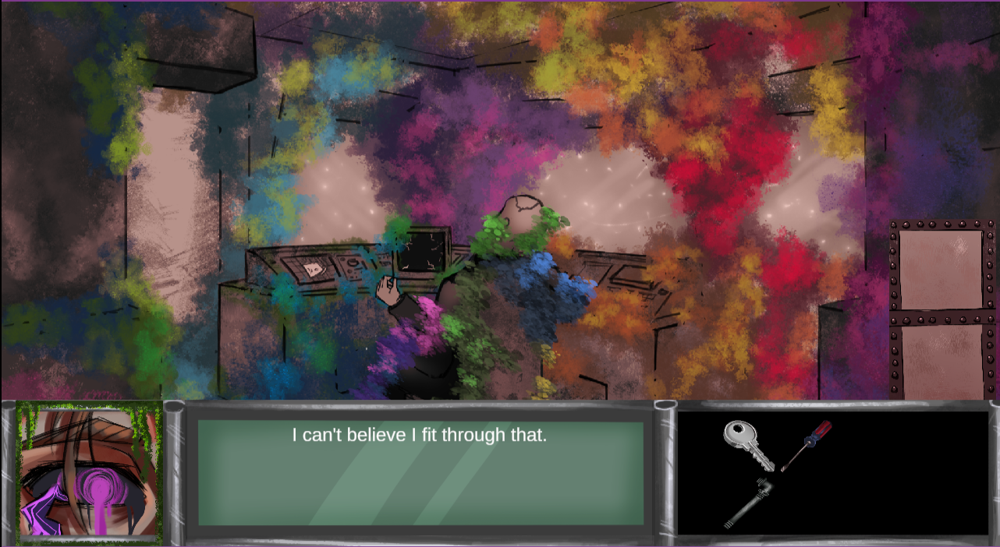
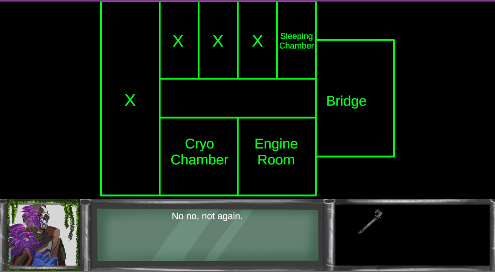
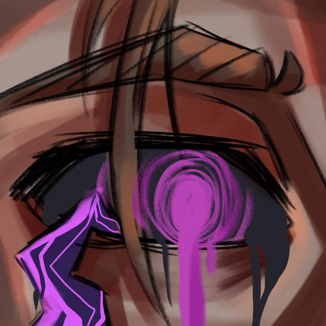

For my third game jam, I signed up for [Eye Jam 2](https://itch.io/jam/the-eye-jam2). This jam centers around Cosmic Horror, of which I am a huge fan. The sub-theme was revealed at the start of the jam to be "decay."

Our team had 5 people. One programmer (myself), two artists, one sound/composer, and one scenario writer. We had one week from the start time of the jam to complete the project.

## Idea Phase

From the beginning we knew the game would have to be cosmic horror related. There was a sub theme revealed at the start of the jam, "decay."

One team member proposed a game that had a "time loop" where the player's body would decay over the course of the game and then be brought back to the beginning. After more deliberation, we decided on a point and click adventure game where the player's time would keep getting reset, bringing them back to a "healthy" state where they would begin to decay again.

## Planning/Design

From the last jam, one thing I wanted to change with this jam was to really set aside time at the start to design the architecture of the code so that the implementation can be simple.

One problem I had last time was there was a lot of spaghetti code and it wasn't really flexible. If I wanted to add a new upgrade, level or pickup, I would have to write more code and make a bunch of changes in different places. While this is somewhat excusable for a 48 hour project, I wanted to change my approach for this project as we had one week.

My approach was to research common ways that people implement point and click adventure games to figure out the best way to implement it within Unity. Given that point and click games often use 2D backgrounds or at a scene with a static camera, I know that managing how players would move between scenes would be important. As well as managing the items, interactables, and all of the different actions that can happen in the game. All while needing to be able to reset EVERYTHING every minute.

## Interactable

The first step was to code up the base interaction system. This would need to detect where the player is clicking on the screen and whether or not they clicked on something of interest.

This was fun to do but ultimately had a simple solution, especially since Unity handles a good amount of the work. Whenever the player clicks on the screen, it grabs the screen position, translates that to a position within the world, which will then fire a raycast forward and return the object that it hit.

The control system fires this raycast, and returns the first "Interactable" that it finds.

## GameActions and Command Pattern

Naturally, coding every interactable object individually is not ideal, so instead, we will implement a [command pattern.](https://refactoring.guru/design-patterns/command)

We will call these game actions. Each interactable object contains a list of game actions, and when the player clicks on this interactable, it will fire every game action within the list. Each GameAction will inherit from a bsae class and use run the Execute function while sending in interaction context into the object that it might need to run the action.

Game published with 13 different types of actions, this allowed us to modify inventory for the player, play sounds, move between rooms, change game states, etc. Many of these have parameters can be set, such as what sound will be played, what items will be changed in the inventory, what room we will change too, the list goes on.

## GameConditions and Specification Pattern

But we don't want every interactable to do the same action everytime it is clicked. So I implemented a [specification pattern](https://matt.berther.io/2005/03/25/the-specification-pattern-a-primer/) to help control when an action fires.

So I created GameConditions in order to help with this. What they do is a single "check" function that goes over some conditions that can be configured and return true if it passes. An example GameCondition would be "CheckHeldItem". This can be created as a scriptable object and set to any item in the game. When the check function is run, it will compare the item the player is currently "holding" to the item that is set in the parameter.

Fortunately since they can configured individually, I only ended up with 3 game actions. And I just change a single parameter when setting it up in Unity.

## Implementation

From this point, the implementation was very easy. I was implementing the assets faster than the artists were producing and sending it to me. The process just involved clicking and dragging images, sounds and text into the Unity editor.

## Group Work

Our team was notably bigger than our previous jam, with it came some new challenges. This section isn't about technical problems or implementation but more so lessons in project management and communication.

The first thing I can look at as a possible improvement to communication is helping to provide more clear design goals for other team mates. During initial discussions, we ended our "meeting" without laying out clear action items for the team. We had action items but they were too vague and open. We ended up losing time because multiple team members did not have clear direction and ended up working on things that were not relelvant to the task or not productive.

So while our scope was appropriate for the week, because of the last point, the artists didn't know what to work on, the scenario writer spent time brainstorming puzzles that would take too much time to implement, and the sound effects team member couldn't make any assets.

After some lost days, I got some of the team members into a call together and we sorted out some of the details better and formed better action items for the following days. After this call, the progress went significantly faster than before.

## Conclusion

This was a great jam to work on, got to work on a project within my favorite genre of fiction and I will absolutely work in EyeJam3 when it's announced.

This project has not only helped increase my confidence but also helped get more experience working with team mates across different disciplines.

