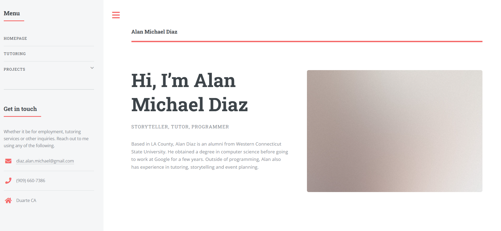
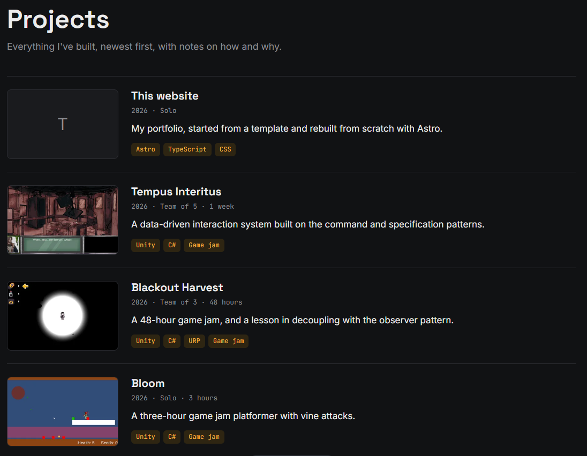

I've always wanted a website, but the task from the ground up always seemed very daunting, lots to learn and do. And I always learn better by simply doing and making iterative progress.

The first step for this website was to grab a template online and iterate on that first. This would allow me to get started immediately and make changes and passively learn this over time.

## GitHub Pages

The first step for a website is to get something hosted and up and running. I used a template from HTML5 UP and got it hosted on GitHub Pages.

## First changes

I started with very simple edits to change the index, sidebar, and the homepage. This was simply changing some text and nothing more.

## Actually I hate this

The website looked incredibly plain and it felt like a template when looking at it. And me no likey. So I scrapped everything and started from scratch, well... almost.

## Runtime vs Build Time
A problem I ran into with the template immediately is that the sidebar is hardcoded into every single page. This created so much extra work for me that I actually just stopped editing the website entirely at one point because of the extra work. My first fix was to move the sidebar into its own file and use a [fetch](https://developer.mozilla.org/en-US/docs/Web/API/Fetch_API/Using_Fetch) with JavaScript. I would then call `initSidebar` once the fetch was complete. The final fix was to switch to Astro, which assembles the pages at build time. So the visitors get the complete pages. No fetching, no weird race conditions, and the bug in its entirety disappeared.

The lesson learned? Sometimes taking a step back to rethink the design helps make the problem easier or erase it completely.

## Astro
One problem I just kept bumping into was that my attempts to reduce repetitive work just made the page more complicated or introduced weird race conditions that made me a little scared. After some research, I decided to use Astro to create the website. One thing I wanted was to keep it "simple" to update my site and add new pages. My experience with working on games taught me that adding good design that can just read the data is way better for my sanity than making new individual pages for everything.

Here are some of the things I liked:
- I loved that I could make the project pages as Markdown and have that load for each project page, with a details section at the top including team size, tags, link, and other pieces of data that is checked against the schema.
- The page is built ahead of time and sent to the user as complete HTML, so no weird fetch/JavaScript timings to worry about.
- I can write certain components once and reuse them forever instead of writing them for each page. e.g., header and footer.
- Pages ship with **almost** no JavaScript.

## Data-Driven Design
The big thing that made me decide to use Astro was when I saw testimonials of people using Markdown to store pages and Astro would load those as pages. I was convinced because I already obsessively use Obsidian in every part of my life for note taking so I was really familiar with making .md pages. So the list of projects [here](/projects) is generated from the existing md files in the src/content/projects folder. And the cards on the home page just read the project files and pick up whichever ones I marked as "featured." So adding a new project is as simple as making another Markdown file and **maybe** flipping the featured setting.

## Performance
I also made some performance improvements. The images went from upwards of 1.4 MB (as they were just raw screenshots) to a much smaller amount such as 82 KB for the same image, as an automatic WebP conversion and resizing feature cuts back on the size. I made the fonts self-hosted instead of needing to fetch from Google, so visitors' browsers don't need to make extra requests to Google, which is faster.

## AI Disclaimer
I finally stopped resisting. I had AI help with a good chunk of the process, but not simply vibe coding the whole thing but using it as a sort of advanced search engine. I had it help make the boilerplate, install it, create the CSS style sheet (because no thanks) and help convert my previous pages from HTML to Markdown.